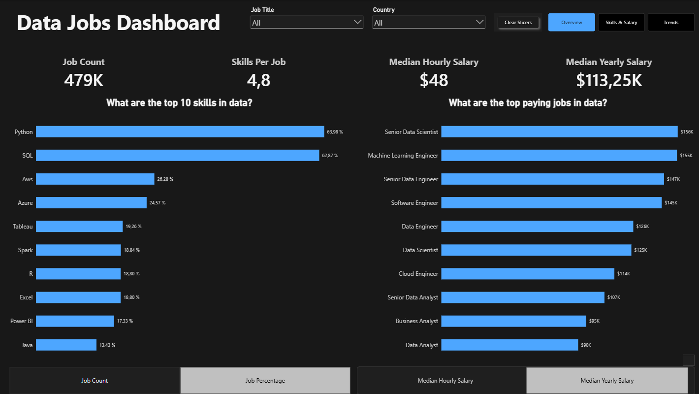
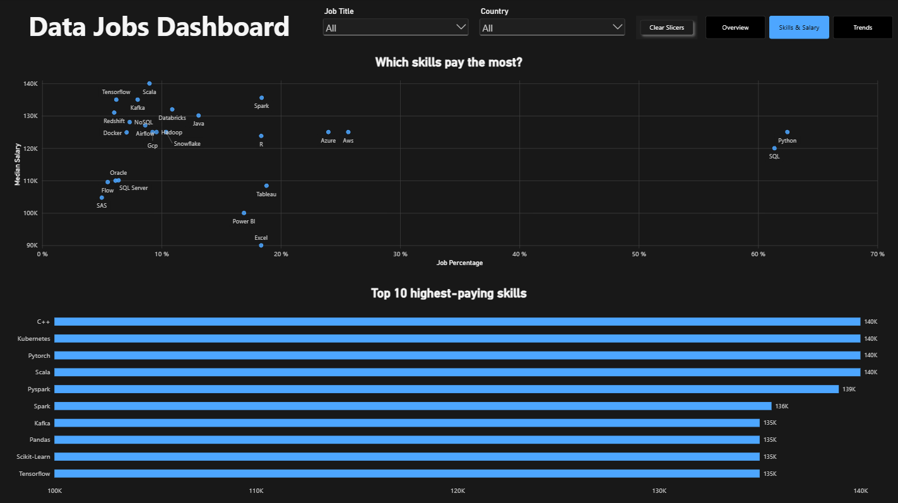
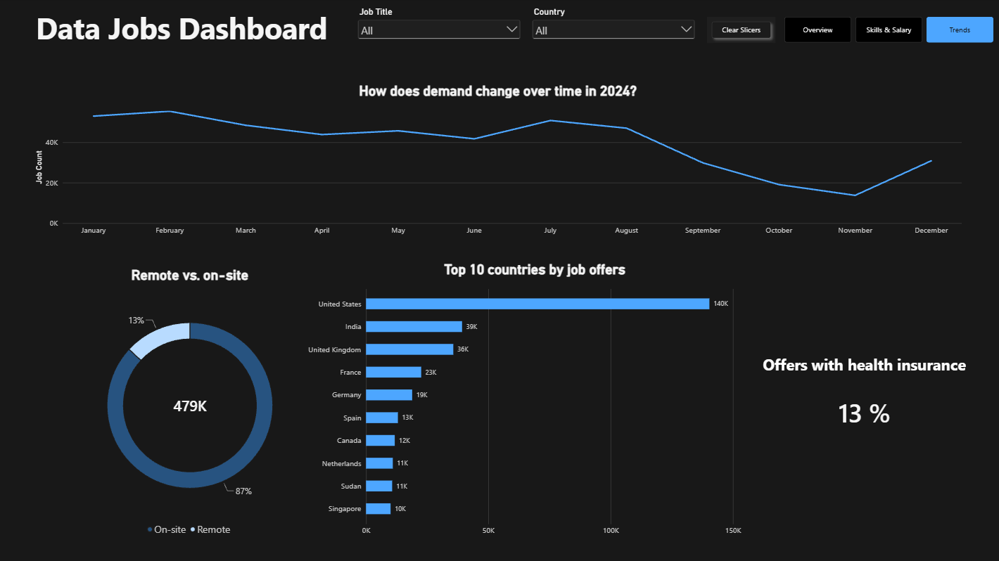
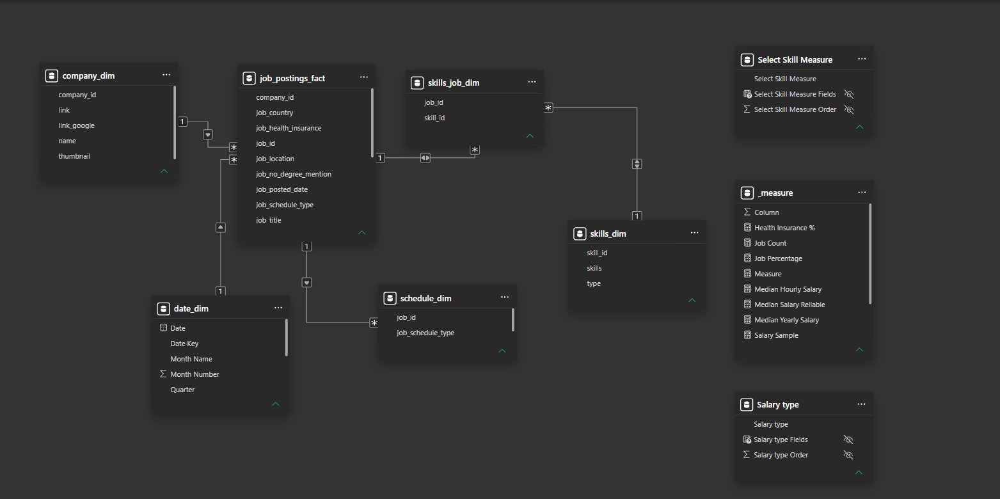

# Data Jobs Dashboard
 
An interactive Power BI dashboard that analyzes 479K data-related job postings from 2024 to answer three questions:
which skills are most in demand, which roles and skills pay the most, and how hiring changes over time.
 

 
## Business questions
1. What are the most requested skills in data roles?
2. Which roles and skills pay the most, and are they also in demand?
3. How does demand vary by month, work mode (remote vs on-site) and country?
 
## Key findings
- **Python (~64%) and SQL (~63%)** appear in about two thirds of postings, followed by AWS (26%), Azure (25%) and Tableau (19%).
- **Median salary:** $113K per year across postings that report salary (hourly postings: $48 per hour).
- **Top paying roles (yearly median):** Senior Data Scientist (~$156K), Machine Learning Engineer (~$155K), Senior Data Engineer (~$147K).
  Data Analyst is the lowest of the ten at ~$90K.
- **Best paid skills** (with at least 500 salaried postings): C++, Kubernetes, PyTorch and Scala at about $140K; PySpark $139K; Spark $136K.
  Python and SQL are the most requested but sit around $120-125K; Excel and Power BI are the lowest paid.
- **Remote work is rare:** about 13% of postings are remote vs 87% on-site.
- **Geography:** the United States has ~140K postings, followed by India (39K), the United Kingdom (36K), France (23K) and Germany (19K).
- **Seasonality:** postings peak in February (~55K) and fall to ~14K in November before rebounding in December [verify: may reflect data collection].
- **Health insurance** is mentioned in about 13% of postings [verify].
 
## Dashboard pages
| Page | Purpose |
|------|---------|
| Overview | KPIs, top 10 skills (% of postings), top paying roles (hourly/yearly toggle) |
| Skills & Salary | Scatter of demand vs salary per skill; top 10 highest paying skills |
| Trends & Conditions | Monthly demand, remote vs on-site, top countries, health insurance |
 


 
## Data model
Star schema: `job_postings_fact` connected to `company_dim`, `date_dim`, `skills_dim` (via `skills_job_dim`) and `schedule_dim`.
Measures live in a dedicated `_measure` table.
 

 
## Key DAX measures
```DAX
Salary Sample = COUNT ( job_postings_fact[salary_year_avg] )
 
Median Salary Reliable =
IF ( [Salary Sample] >= 500, [Median Yearly Salary] )
 
Job Count = 
COUNTROWS(job_postings_fact)
 
Health Insurance % =
DIVIDE (
    CALCULATE ( [Job Count], job_postings_fact[job_health_insurance] = TRUE () ),
    [Job Count]
)

Job Percentage = DIVIDE([Job Count], CALCULATE([Job Count], ALLSELECTED(skills_dim)))

Median Hourly Salary = MEDIAN(job_postings_fact[salary_hour_avg])

Health Insurance % = 
DIVIDE (
    CALCULATE ( [Job Count], job_postings_fact[job_health_insurance] = TRUE () ),
    [Job Count]
)
```
 
## Methodology and limitations
- Salary statistics use **medians**, not averages, to limit the effect of outliers.
- Skill-level salaries require **at least 500 postings with salary data**. Very small samples produced unstable, inflated medians.
- Only a fraction of postings report salary, and most of those are in the United States. All salaries are in USD.
- Hourly and yearly salaries are analyzed separately.
- Data covers 2024 only; monthly trends may partly reflect how the data was collected.
 
 
## How to use
1. Download `data-jobs-dashboard.pbix` and open it with Power BI Desktop.
2. Use the slicers (Job Title, Country) and the page navigator at the top. Ctrl + click activates buttons in Desktop.
 
## Tools
Power BI Desktop, Power Query (M), DAX, star-schema modeling.
 
## Data source
Built following Luke Barousse's Power BI course; layout, additional pages (skills vs salary, trends), reliability threshold and analysis are my own. 

https://github.com/lukebarousse/PowerBI_Data_Analytics_Course

